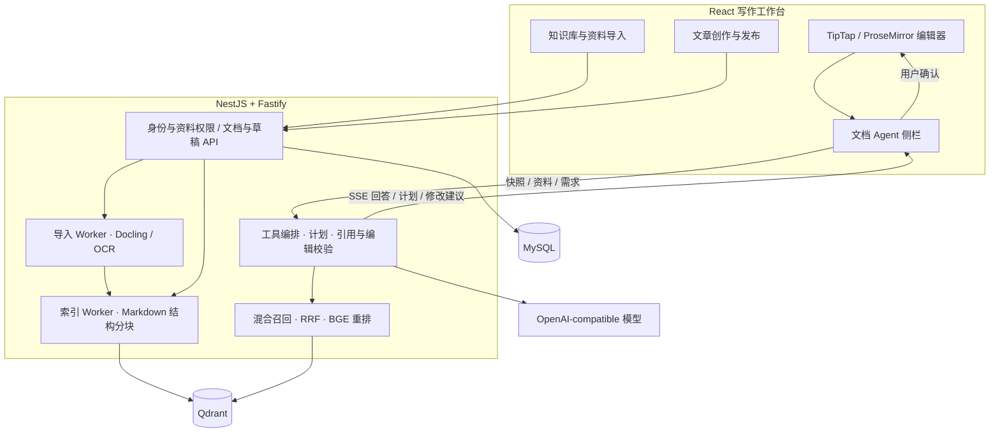

# LiveDoc · 智能文档工作台

LiveDoc 将知识资料、富文本编辑器和文档 Agent 放在同一个工作台中。从导入资料、检索原文，到规划文章、预览修改和发布内容，让知识积累直接参与写作。

项目受掘金的内容创作体验启发，进一步加入个人知识库、RAG 检索与上下文感知写作。AI 可以读取资料、提出计划和生成修改建议，正文由用户确认后更新。

[主要功能](#主要功能) · [界面预览](#界面预览) · [快速开始](#快速开始) · [系统架构](#系统架构) · [开发与验证](#开发与验证)

> 本仓库为 React 前端，当前后端为 [LiveDoc NestJS Server](https://github.com/seren-spark/livedoc_server_nest)。旧 Python 服务与多人协同编辑已停止维护。

## 主要功能

| 模块       | 能做什么                                                                           |
| ---------- | ---------------------------------------------------------------------------------- |
| 文档编辑   | 基于 TipTap / ProseMirror 编辑标题、列表、表格、代码、图片和公式，通过目录浏览长文 |
| 个人知识库 | 用最多三级分类整理文档，移动分类、使用笔记模板，并在回收站恢复资料                 |
| 资料导入   | 上传 PDF / Word，后台解析后进入编辑器预览、修改，确认保存后建立检索索引            |
| 知识检索   | 按个人、团队、公开资料及指定文档限定范围，结合关键词与向量检索找到相关原文         |
| 文档 Agent | 在 Ask、Plan、Agent 三种模式间切换，读取资料、回答问题、规划文章和提出编辑建议     |
| 定向编辑   | 结合正文、选区与光标上下文定位修改，查看前后对比，逐项接受或拒绝，支持撤销         |
| 引用核对   | 点击引用查看证据片段，并在版本与位置有效时定位原文                                 |
| 独立文稿   | 生成新文稿，预览表格与重点内容，保存为私有草稿或下载 Markdown                      |
| 文章发布   | 管理草稿、发布和撤回文章，支持公开阅读、评论、回复、点赞与收藏                     |
| 检索观测   | 查看索引状态、检索延迟、无依据率与内容采纳率；技术详情按需展开                     |

联网检索、网页读取与深度思考由后端配置和模型能力决定；界面按实际可用能力提供入口。团队共享用于控制资料访问范围，编辑流程以个人操作为主。

## 界面预览

以下截图来自本地联调，正文、账号与生成内容为示例，用于展示编辑和确认流程。

**写作工作台：目录、富文本正文与结构化排版。**


| 可调整的写作计划                                                        | 逐项确认的正文修改                                                           |
| ----------------------------------------------------------------------- | ---------------------------------------------------------------------------- |
|  |  |
| 执行前调整目标、章节和约束，保存后再开始编写                            | 查看原文与建议的差异，决定每一处修改是否进入正文                             |

## 从资料到文稿

1. **收集资料**：在知识库新建文档，或上传 PDF / Word；解析完成后先核对正文。
2. **整理知识**：保存资料并建立索引，用分类和标签管理内容，按需选择个人、团队或公开资料范围。
3. **提问或规划**：在编辑器打开「AI 助手」，附加参考资料，先问清内容或整理写作计划。
4. **预览并采纳**：对照引用检查生成内容，接受所需修改，或保存为独立私有草稿。
5. **继续创作与发布**：知识文档保存到知识库；文章草稿通过创作者中心发布、更新或撤回。

### 三种助手模式

| 模式         | 适用场景                               | 操作方式                                     |
| ------------ | -------------------------------------- | -------------------------------------------- |
| Ask · 问答   | 解释概念、阅读资料、核对原文           | 返回回答与引用，不提供正文修改               |
| Plan · 规划  | 整理提纲、明确写作要求、拆解复杂任务   | 先生成可编辑计划，点击「按此计划执行」后编写 |
| Agent · 编写 | 润色选区、补充段落、重组正文或生成文稿 | 选择当前文档或独立文稿，预览后采纳           |

通过工具栏「AI 助手」或 `Ctrl / Cmd + Shift + K` 打开侧栏。参考资料支持知识文档、PDF、DOCX、TXT 和 Markdown；附件解析完成后可用于当前任务，不会自动存入知识库。

正文修改以发送时的编辑器快照为依据。生成过程中继续编辑，会使受影响的建议提示冲突；切换文档会取消当前任务。引用保留当时的原文和版本，来源变化后可对照片段核查。

## 快速开始

### 环境要求

| 组件     | 要求与用途                                                                            |
| -------- | ------------------------------------------------------------------------------------- |
| Node.js  | 22.12+，运行前端与 NestJS 服务                                                        |
| npm      | 10+，安装依赖与运行脚本                                                               |
| MySQL    | 8.x，保存文档、草稿、任务、会话与反馈                                                 |
| Qdrant   | 保存 Dense / Sparse 检索索引                                                          |
| Python   | 用于 Docling / RapidOCR 文档解析，安装方式见后端配置文档                              |
| 模型服务 | 支持工具调用的 OpenAI-compatible 接口；Embedding 与 BGE 重排通过 Transformers.js 加载 |

当前提供源码运行方式。首次配置数据库、模型和解析环境，请先阅读 [本地真实 RAG 配置](https://github.com/seren-spark/livedoc_server_nest/blob/main/docs/LOCAL_REAL_RAG_SETUP.md)。

### 1. 获取前后端

在同一个父目录检出两个仓库：

```bash
git clone --branch feat/knowledge https://github.com/seren-spark/livedoc.git
git clone https://github.com/seren-spark/livedoc_server_nest.git
```

### 2. 配置并启动后端

在后端目录执行；以下复制命令使用 PowerShell：

```powershell
cd livedoc_server_nest
npm ci
Copy-Item .env.example .env
```

编辑 `.env`，配置数据库、Qdrant、模型接口和解析 Python 路径。保留示例中的真实运行模式，按实际前端地址设置 `ALLOWED_ORIGINS`。模型首次加载需要下载或准备本地缓存。

配置完成且 MySQL、Qdrant 已启动后执行：

```powershell
npm run db:migrate
npm run qdrant:init
npm run config:check:live
npm run dev
```

`npm run dev` 会同时启动 API、索引 Worker 和导入 Worker。只启动 API 时，解析或索引任务不会被消费。默认 API 的存活检查地址为 [http://127.0.0.1:8001/health/live](http://127.0.0.1:8001/health/live)。

### 3. 启动前端

另开终端，从检出仓库的父目录进入前端：

```powershell
cd livedoc
npm ci --legacy-peer-deps
Copy-Item .env.example .env.local
npm run dev
```

`.env.local` 中与当前主流程相关的配置为：

```dotenv
VITE_RAG_API_BASE_URL=http://127.0.0.1:8001
VITE_ENABLE_MOCK=false
```

打开终端输出的 Vite 地址，默认通常为 [http://localhost:5173](http://localhost:5173)。端口变化时，同步调整后端 `ALLOWED_ORIGINS`。`VITE_API_BASE_URL` 为既有业务接口配置，知识库、文档 Agent 和文章主流程使用 `VITE_RAG_API_BASE_URL`。

### 4. 体验完整流程

在登录窗口选择演示账号，默认密码为 `Demo@123456`：

| 账号                  | 资料权限体验                      |
| --------------------- | --------------------------------- |
| `alice@livedoc.local` | Alice 的个人资料与 Alpha 团队资料 |
| `bob@livedoc.local`   | Bob 的个人资料与 Alpha 团队资料   |
| `carol@livedoc.local` | Carol 的个人资料与 Beta 团队资料  |

进入知识库，点击「演示数据」准备资料，或自行创建、导入文档。等待索引就绪后打开编辑器，即可体验检索、引用核对与写作。演示身份用于本地联调。

| 页面           | 路径                           |
| -------------- | ------------------------------ |
| 知识库管理     | `/knowledge`                   |
| 文章写作       | `/editor/draft`                |
| 知识文档写作   | `/editor/draft?mode=knowledge` |
| 草稿与发布管理 | `/creator/articles`            |
| 收藏文章       | `/creator/favorites`           |
| 公开文章列表   | `/synthesis`                   |
| 文章阅读       | `/post/:id`                    |

## 系统架构



### 检索如何参与写作

- **入库**：Markdown 按结构与 Token 预算分块，生成稠密向量与稀疏向量，写入 Qdrant。
- **召回**：结合关键词与语义检索，经 RRF 融合、BGE 重排、去重和上下文压缩选取证据。
- **权限**：根据当前用户、资料范围、发布状态与有效索引版本约束可读取内容。
- **生成**：通过工具调用读取证据，返回带引用的回答、计划或结构化修改建议。
- **确认**：前端先展示结果与差异，检查引用和编辑位置，再由用户采纳；反馈关联对应运行记录。

### 技术栈

| 领域       | 技术                                                                    |
| ---------- | ----------------------------------------------------------------------- |
| 前端       | React 18、TypeScript、Vite 7、React Router                              |
| 编辑器     | TipTap 3、ProseMirror、自定义 Extension / Plugin                        |
| 界面与状态 | Ant Design 5、UnoCSS、Sass、Redux Toolkit、TanStack Query               |
| 内容渲染   | React Markdown、remark-gfm、KaTeX、highlight.js                         |
| 后端       | Node.js、TypeScript、NestJS 11、Fastify 5                               |
| 存储与任务 | MySQL、TypeORM、持久化任务队列、本地文件存储                            |
| 检索与推理 | Qdrant、Jieba、Transformers.js、BGE Embedding / Reranker、Worker Thread |
| 解析与评测 | Docling、RapidOCR；EvalScope、MTEB、RAGAS                               |

## 开发与验证

### 前端

在本仓库根目录执行：

```bash
npm test
npx tsc -p tsconfig.app.json --noEmit
npm run build
```

`npm run build` 包含 TypeScript project build 与 Vite 生产构建。格式与静态检查入口为 `npm run format:check`、`npm run lint:check`。

### 后端与真实链路

在 `livedoc_server_nest` 中执行：

```bash
npm run type-check
npm test
npm run build
npm run validate:e2e:real
```

真实验收覆盖导入、确认入库、索引、检索、工具调用、生成、引用与反馈；需要已配置的数据库、模型和解析环境。

### RAG 评测

后端提供冻结语料、问题与 Chunk 标注，用于检索策略对比、实际入模证据核验和答案质量分析。入口包括：

| 入口                           | 用途                                                    |
| ------------------------------ | ------------------------------------------------------- |
| `npm run eval:retrieval:fixed` | 计算 Chunk Recall、MRR、NDCG 与候选池覆盖，保留失败样例 |
| `npm run eval:answers`         | 采集实际问答及该轮使用的证据                            |
| `npm run eval:judge`           | 核验回答、参考事实与证据的支持关系                      |
| `npm run eval:frameworks`      | 通过 EvalScope / MTEB / RAGAS 运行模型与生成质量评测    |

题集准备、运行参数、原始结果和适用范围见 [RAG 评测指南](https://github.com/seren-spark/livedoc_server_nest/blob/main/docs/rag-evaluation.md)。合成题集的结果用于回归和机制诊断，业务效果需要真实资料与人工复核。

## 项目结构

```text
src/
├── api/
│   ├── rag.ts                     # 知识库、导入、引用、检索与反馈接口
│   ├── document-agent.ts          # Agent 请求与 SSE 事件消费
│   ├── workspace.ts               # 分类、模板与回收站
│   └── articles.ts                # 文章草稿、发布与互动
├── components/Knowledge/
│   ├── DocumentAgentPanel.tsx     # 文档助手、参考资料与结果预览
│   ├── AgentPlanEditor.tsx        # 写作计划编辑
│   ├── AgentMarkdown.tsx          # 表格、高亮与引用渲染
│   └── WorkspaceNavigation.tsx    # 个人分类、模板与回收站入口
├── hooks/
│   ├── useKnowledgeDocumentSession.ts
│   └── useArticleSession.ts       # 知识文档与文章的保存流程
├── lib/
│   ├── document-agent-editor.ts   # 编辑建议、冲突检测与采纳事务
│   └── citation-location.ts       # 引用定位
└── pages/
    ├── knowledge/                # 知识库管理
    ├── editor/                   # 写作工作台与编辑器扩展
    ├── creator/                  # 创作者中心
    └── post/                     # 文章阅读
```

## 更多文档

- [后端概览与运行说明](https://github.com/seren-spark/livedoc_server_nest)
- [本地真实 RAG 配置](https://github.com/seren-spark/livedoc_server_nest/blob/main/docs/LOCAL_REAL_RAG_SETUP.md)
- [文档 Agent、个人知识管理与可选能力](https://github.com/seren-spark/livedoc_server_nest/blob/main/docs/document-agent.md)
- [Markdown 结构分块](https://github.com/seren-spark/livedoc_server_nest/blob/main/docs/MARKDOWN_CHUNKING.md)
- [RAG 评测与结果说明](https://github.com/seren-spark/livedoc_server_nest/blob/main/docs/rag-evaluation.md)

## 参考

- [掘金](https://juejin.cn/)：内容创作与文章阅读场景。
- [LearnHub](https://github.com/luyiyanyumu/LearnHub)：知识工作台的展示方式与固定知识库评测思路。
