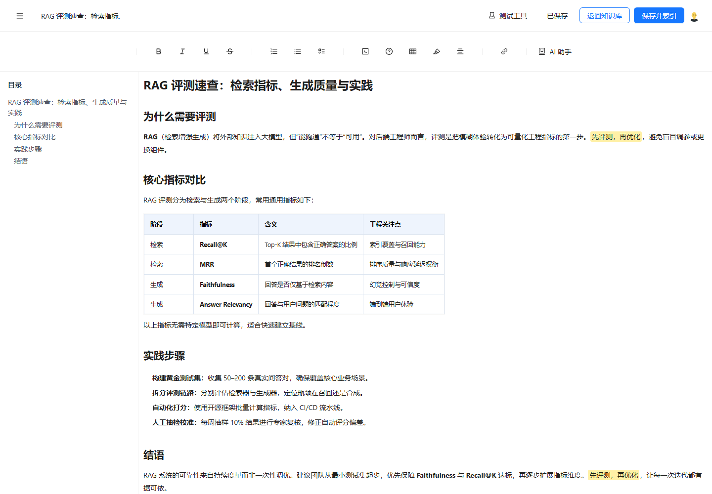
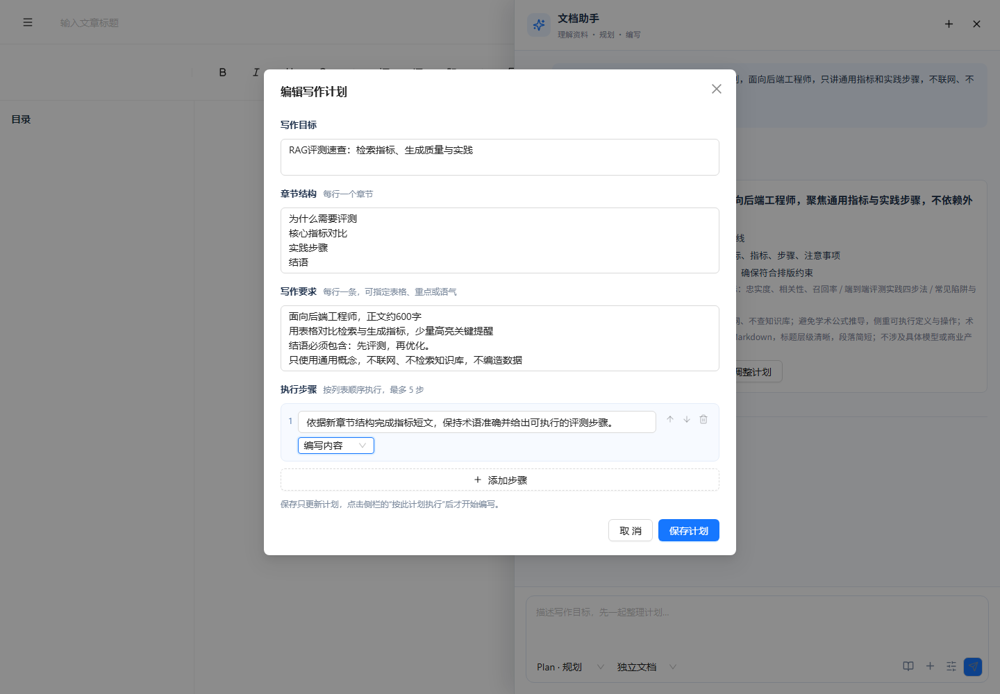
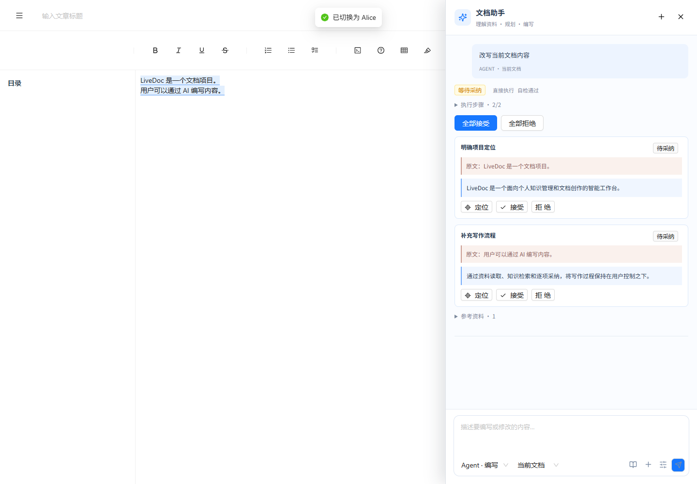
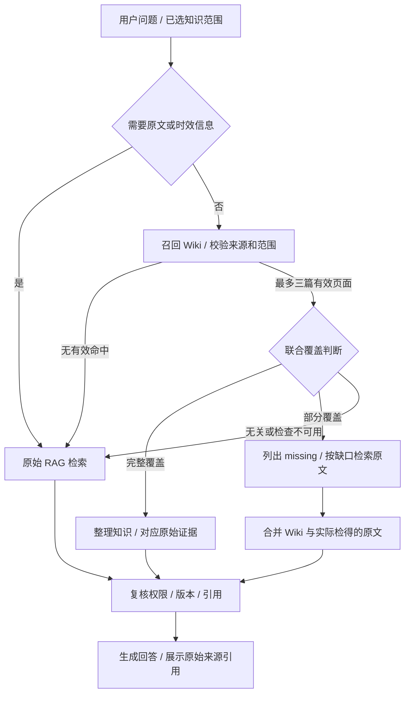
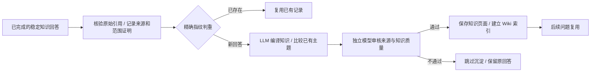
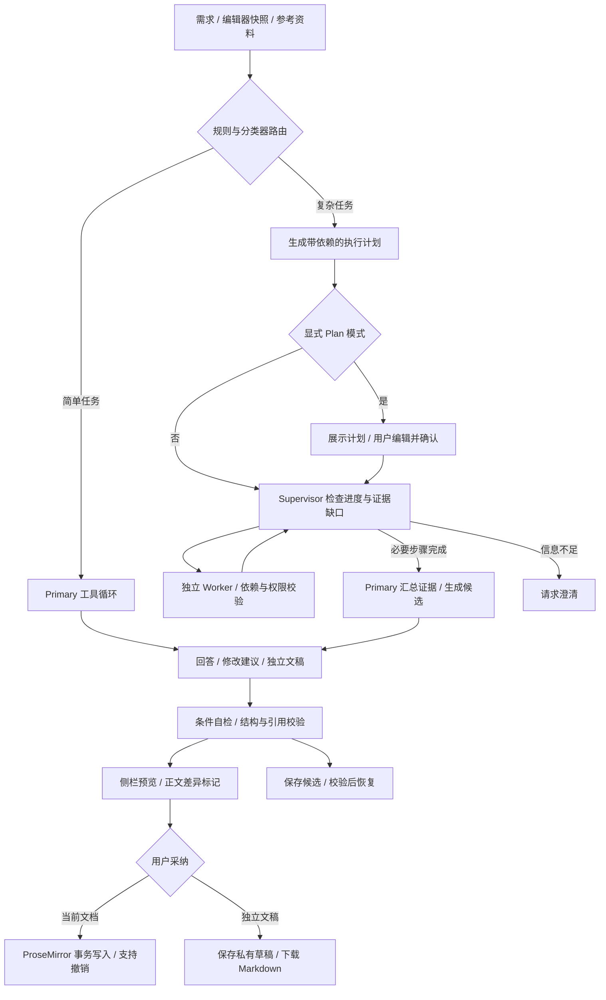
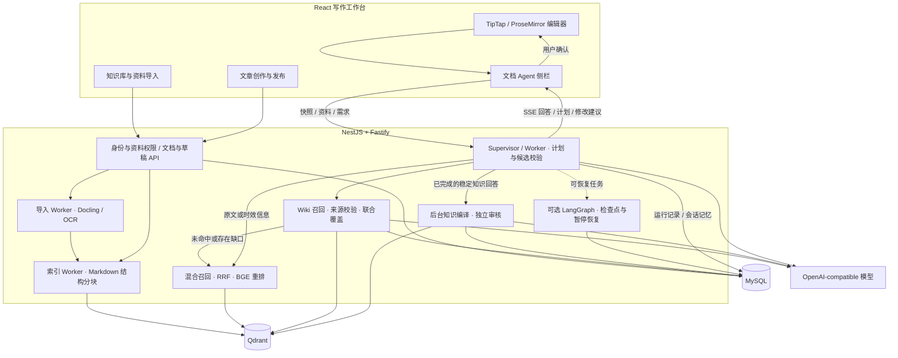

# LiveDoc · 智能文档工作台

LiveDoc 是面向个人知识管理与创作的智能文档工作台，支持资料导入、知识检索、AI 辅助写作与文章发布。

受掘金创作体验启发，项目结合富文本编辑器、**LLM Wiki + RAG** 与上下文感知 Agent：从原文检索证据，将审核后的知识用于后续问答，正文修改由用户确认后写入。

[主要功能](#主要功能) · [界面预览](#界面预览) · [Wiki + RAG 机制](#llm-wiki--rag-机制) · [Agent 实现](#文档-agentplan-and-execute-与工具执行) · [快速开始](#快速开始) · [系统架构](#系统架构) · [开发与验证](#开发与验证)

> 本仓库为 React 前端，后端见 [LiveDoc NestJS Server](https://github.com/seren-spark/livedoc_server_nest)。旧 Python 服务与多人协同编辑已废弃。

## 主要功能

| 模块       | 能做什么                                                   |
| ---------- | ---------------------------------------------------------- |
| 文档编辑   | TipTap 富文本编辑，支持目录、表格、代码、图片和公式        |
| 个人知识库 | 三级分类、笔记模板、文档移动与回收站                       |
| 资料导入   | PDF / Word 解析、预览，确认保存后建立索引                  |
| 知识检索   | 在个人、团队、公开或指定文档内进行关键词与向量检索         |
| 知识沉淀   | 稳定回答整理为 LLM Wiki，后续提问按缺口补查原文            |
| 文档 Agent | Ask 问答、Plan 规划、Agent 编写三种模式                    |
| 定向编辑   | 基于正文、选区与光标提出修改，支持差异预览、逐项采纳和撤销 |
| 引用核对   | 查看证据片段，来源有效时定位原文                           |
| 独立文稿   | 生成新文稿，保存私有草稿或下载 Markdown                    |
| 结果恢复   | 校验正文与来源后恢复已完成结果、待处理建议及反馈           |
| 文章发布   | 草稿、发布、撤回，以及评论、回复、点赞与收藏               |
| 检索观测   | 索引状态、检索延迟、无依据率与采纳率                       |

联网、网页读取与深度思考按后端配置和模型能力开放；团队共享仅用于资料访问。

## 界面预览

本地联调截图，内容为示例。

**写作工作台：目录、富文本正文与结构化排版。**



| 可调整的写作计划                                                        | 逐项确认的正文修改                                                           |
| ----------------------------------------------------------------------- | ---------------------------------------------------------------------------- |
|  |  |
| 调整计划后执行                                                          | 对照差异，逐项采纳                                                           |

## 从资料到文稿

1. **收集**：新建知识文档，或导入 PDF / Word 并核对解析结果。
2. **整理**：分类、保存并建立索引，选择本次可用的资料范围。
3. **创作**：打开 AI 助手，附加参考资料，提问或规划文章。
4. **采纳**：核对引用和差异，接受修改或保存独立草稿。
5. **发布**：知识文档归入知识库，文章通过创作者中心发布、更新或撤回。

### 三种助手模式

| 模式         | 适用场景                     | 操作方式             |
| ------------ | ---------------------------- | -------------------- |
| Ask · 问答   | 解释概念、阅读资料、核对原文 | 返回回答与引用       |
| Plan · 规划  | 整理提纲、明确要求、拆解任务 | 编辑计划，确认后执行 |
| Agent · 编写 | 润色、补充、重组或生成文稿   | 预览修改后采纳       |

通过工具栏「AI 助手」或 `Ctrl / Cmd + Shift + K` 打开侧栏。支持知识文档及 PDF、DOCX、TXT、Markdown 附件；附件仅用于当前任务，不自动入库。

修改基于发送时的正文快照，手动改动目标内容会触发冲突提示。刷新后可恢复最近结果，采纳前会重查正文、资料权限与版本。默认路径不续跑未完成任务；启用可恢复任务后的行为见[执行状态、取消与预算](#7-执行状态取消与预算)。

## LLM Wiki + RAG 机制

两层知识统一通过 `search_knowledge_base` 供 Agent 使用，引用始终指向原始证据。

| 知识层         | 保存内容                         | 用途                         |
| -------------- | -------------------------------- | ---------------------------- |
| 原始资料 / RAG | 用户文档、结构化分块及检索索引   | 查原文、补充缺失或时效信息   |
| LLM Wiki       | 审核后的知识正文、来源与版本证明 | 复用稳定知识，判断问题覆盖度 |

### 1. 提问时：先查有效 Wiki，按缺口补查原文



最多选取三篇有效 Wiki，联合判断是否覆盖用户要求；同义问法或旧知识子集可直接复用。

| 覆盖结果             | 处理方式                                       |
| -------------------- | ---------------------------------------------- |
| `full`               | 返回整理知识及经核验的原始证据                 |
| `partial`            | 列出 `missing`，补查原文；未找到的内容明确说明 |
| `none / unavailable` | 回退原始 RAG                                   |

Wiki 查询与覆盖检查最多占用 15 秒；失效、超时或超出上下文容量时回查原文，取消或总预算耗尽时停止。

### 2. 回答后：后台编译、审核与知识沉淀



仅沉淀已完成、适合稳定复用且引用可追溯知识文档的回答。后台保留来源与范围证明，编译知识后另行调用模型审核事实、限制与引用，通过后保存并索引。

当前编辑快照、网页摘要和无可靠来源的内容不直接沉淀；后台失败不影响已完成回答，也不修改原始资料。

### 3. 知识演进：去重、补充与冲突处理

| 与已有 Wiki 的关系 | 处理方式                                           |
| ------------------ | -------------------------------------------------- |
| 回答与来源指纹相同 | 跳过重复编译                                       |
| 语义重复           | 编译与审核均确认事实、限制和来源已覆盖后，复用旧页 |
| 兼容补充           | 保留旧知识，追加有据内容，整体审核后生成新版本     |
| 独立主题           | 单独保存，避免仅凭标题或来源合并                   |
| 同条件下事实冲突   | 两轮确认后标记冲突，停止旧知识复用，回查原文       |

### 4. 来源失效与回答纠错

Wiki 仅在所有来源可访问、版本与片段证明有效且符合当前范围时复用。文档更新、删除、撤权或范围变化会使旧知识失效，检索回到原文。

将回答标为「有误」会取消其待完成沉淀，撤回它产生或直接采用的 Wiki，并使相关派生版本失效；原始资料保留。

后台沉淀队列位于进程内，重启不续跑；暂不支持全库自动重编或自动解决所有冲突。详见[后端机制说明（工作区）](../livedoc_server_nest/README.md#llm-wiki--rag-机制)与 [Wiki 检索验收记录](../docs/wiki-retrieval-acceptance.md)。

## 文档 Agent：Plan-and-Execute 与工具执行

核心流程为 **Supervisor 调度 → 独立 Worker 工具循环 → 条件自检 → 人工确认**。`DocumentAgentService` 管理根任务，Supervisor 调度步骤，Runtime 隔离 Primary、Reader、Researcher 的上下文与工具权限。

Ask / Plan / Agent 决定产出形式，`react / plan_execute` 决定执行策略；可选 LangGraph 路径负责检查点与暂停恢复。



### 1. 路由：简单任务直接处理，复杂任务先规划

规则优先识别已确认计划和显式 Plan 模式；选区润色、续写等简单任务进入 `react`，多资料综合、全文重组等任务进入 `plan_execute`。

其余请求由分类模型判断；分类或自动规划失败时回退到直接工具循环，保留模式与资料权限约束。

### 2. Plan：把写作目标变成可执行步骤

`ExecutionPlan` 包含四类信息：

| 字段          | 用途                                                 |
| ------------- | ---------------------------------------------------- |
| `goal`        | 任务目标                                             |
| `outline`     | 章节结构                                             |
| `constraints` | 篇幅、语气、资料范围与排版要求                       |
| `steps`       | 最多 5 步，声明依赖及 `read / search / compose` 能力 |

Supervisor 校验依赖并调度 Worker：Reader 读取资料，Researcher 检索证据，独立读／查步骤最多并发 3 个，编写步骤单独执行。各步骤交接 `findings / missing / conflicts` 及实际证据，最终由 Primary 汇总；修改正文前，Primary 必须自行读取目标。

显式 **Plan 模式**等待用户编辑并确认计划，手动调整后的步骤按列表顺序执行；**Agent 模式**可自动规划并继续执行。主管最多补查一次，总计不超过 5 步；信息不足时澄清，必要步骤失败时停止。

### 3. Execute：工具选择、执行与结果观察

工具循环依次完成：模型选工具 → 服务端校验参数 → 执行并返回结果 → 继续读取、检索或提交候选。

| 工具                               | 作用                           |
| ---------------------------------- | ------------------------------ |
| `read_current_document`            | 按区域、选区或分页读取正文快照 |
| `read_reference`                   | 分页读取本轮参考资料           |
| `search_knowledge_base`            | 在授权范围内检索 Wiki 与原文   |
| `list_templates` / `read_template` | 获取写作模板                   |
| `list_categories`                  | 读取个人分类                   |
| `search_web` / 已授权 MCP 工具     | 按配置与联网开关获取外部资料   |
| `finish_answer`                    | 提交回答或步骤结果             |
| `submit_plan`                      | 提交计划并等待确认             |
| `request_clarification`            | 请求补充信息                   |
| `propose_document_edits`           | 提交插入、替换或删除建议       |
| `propose_new_document`             | 提交独立文稿                   |

工具集按模式、输出位置和资料权限裁剪。Ask 只读，计划步骤返回中间结果，最终编写阶段才能提交编辑或文稿。

协议错误允许修复一次，指定临时模型故障最多重试一次；权限、来源版本或预算失效时停止，不自动重放工具。

### 4. 上下文与记忆：先看结构，再按需读原文

前端发送文档身份、版本、TipTap JSON、选区与光标上下文。模型先看到区域目录、短预览、资料清单和适用记忆，再通过工具读取原文。

- 区域以 `b0`、`b1` 等标识定位；修改前必须读完目标，选区修改需精确读取选区。
- 长文分页读取；工具历史可压缩，但保留引用和分页信息，精确改写时重读原文。
- 每次调用检查 Token 预算，仍超窗时提示缩小范围；未读完全文时说明实际读取范围。
- 当前快照优先于历史未采纳候选。

### 5. Reflection：有条件地检查与修正候选

独立文稿、多条修改，以及深度思考下的回答或编辑，会触发一次模型自检，检查要求遗漏、证据、矛盾与结构。发现问题最多修正一次，再执行结构校验。

自检失败时标记「自检未完成」；候选仍需通过权限、引用及编辑范围校验，并由用户确认。可恢复任务新版路径另有证据核验与受限纠错。

### 6. Human-in-the-loop：从候选到可撤销的编辑

编辑建议使用 `insert_before / insert_after / replace / delete`，附带目标、解释与引用。服务端检查已读范围、重叠、格式和来源有效性。

前端通过 ProseMirror Decoration 标记位置，侧栏展示差异；接受后才转换为编辑器节点并通过事务写入。位置映射跟踪手动编辑，目标变化时提示冲突，全部接受可一次撤销。独立文稿保存为私有、未索引草稿。

### 7. 执行状态、取消与预算

默认使用 `POST /ai/agent` SSE 推送计划、步骤、工具、自检与结果，以 `run_id`、递增 `seq` 和 `done` 校验事件。回答和文稿在候选校验后分段发送。

| 控制项     | 默认行为                                                         |
| ---------- | ---------------------------------------------------------------- |
| 步骤与并发 | 最多 5 步（受循环预算限制），独立读／查最多并发 3 个             |
| 工具循环   | 默认共享 24 轮，常规单步最多 4 轮；研究写作 Researcher 最多 8 轮 |
| 模型预算   | 最多 30 次请求、120000 Token，覆盖分类、主管、压缩、自检等调用   |
| 交付预留   | 为最终汇总预留 8192 Token 和两次请求                             |
| 超时与取消 | 总时限 300 秒；默认路径停止、切换文档或断连会取消任务            |
| 人工处理   | 候选等待采纳，信息不足时等待补充                                 |
| 结果恢复   | 重查权限、版本与正文，过滤已处理建议                             |
| 运行记录   | 保存候选、引用、反馈及调用元数据，不记录原始推理链               |

预算、超时与模型通过后端 `AGENT_*` 配置；单 API 默认最多并发 6 个任务。默认路径不续跑未完成任务，数据库降级为内存后无法跨重启恢复。

设置 `AGENT_GRAPH_ENABLED=true` 并使用 MySQL 后，可启用 **LangGraph 可恢复任务**：通过 `/ai/agent/runs` 创建任务、订阅事件、暂停与恢复，检查点保存到 MySQL，订阅断开后任务仍可在后台运行。新版路径还支持证据核验与研究写作流程；具体能力按服务端配置开放。

### 8. 关键源码

| 入口                                                                                                                      | 实现内容                                               |
| ------------------------------------------------------------------------------------------------------------------------- | ------------------------------------------------------ |
| [DocumentAgentService](https://github.com/seren-spark/livedoc_server_nest/blob/main/src/ai/document-agent.service.ts)     | 根任务生命周期、路由、自检、候选校验与恢复             |
| [AgentSupervisorService](https://github.com/seren-spark/livedoc_server_nest/blob/main/src/ai/agent-supervisor.service.ts) | 依赖调度、补查、汇总与澄清决策                         |
| [AgentRuntimeService](https://github.com/seren-spark/livedoc_server_nest/blob/main/src/ai/agent-runtime.service.ts)       | 独立 Worker 上下文、角色工具权限和实际证据交接         |
| [预算与失败策略](https://github.com/seren-spark/livedoc_server_nest/blob/main/src/ai/agent-execution.ts)                  | 并发预算预留、错误分类与调用追踪                       |
| [Agent 结果校验](https://github.com/seren-spark/livedoc_server_nest/blob/main/src/ai/document-agent.validation.ts)        | 计划无环检查、模式约束、引用、Markdown 与修改范围校验  |
| [LLM 适配](https://github.com/seren-spark/livedoc_server_nest/blob/main/src/ai/llm.service.ts)                            | 角色模型选择、Function Calling 与思考参数              |
| [可恢复任务](https://github.com/seren-spark/livedoc_server_nest/tree/main/src/ai/graph)                                   | LangGraph 工作流、MySQL 检查点与任务控制               |
| [DocumentAgentPanel](src/components/Knowledge/DocumentAgentPanel.tsx)                                                     | 发送快照、展示进度、引用预览、候选采纳、取消与刷新恢复 |
| [AgentPlanEditor](src/components/Knowledge/AgentPlanEditor.tsx)                                                           | 用户编辑目标、章节、要求与步骤                         |
| [编辑器事务](src/lib/document-agent-editor.ts)                                                                            | 快照、Decoration、位置映射、冲突检测与事务采纳         |
| [Agent 请求客户端](src/api/document-agent.ts)                                                                             | 事件解析、顺序校验、终态检查及结果恢复接口             |
| [回答反馈](src/components/Knowledge/AgentAnswerFeedback.tsx)                                                              | 回答质量反馈与已保存反馈状态恢复                       |

## 快速开始

### 环境要求

| 组件     | 要求与用途                                                                            |
| -------- | ------------------------------------------------------------------------------------- |
| Node.js  | 22.12+，运行前端与 NestJS 服务                                                        |
| npm      | 10+，安装依赖与运行脚本                                                               |
| MySQL    | 8.x，保存文档、草稿、任务、会话与反馈                                                 |
| Qdrant   | 保存 Dense / Sparse 检索索引                                                          |
| Python   | 用于 Docling / RapidOCR 文档解析，安装方式见后端配置文档                              |
| 模型服务 | 支持工具调用的 OpenAI-compatible 接口；Embedding 与 BGE 重排通过 Transformers.js 加载 |

首次配置请先阅读 [本地真实 RAG 配置](https://github.com/seren-spark/livedoc_server_nest/blob/main/docs/LOCAL_REAL_RAG_SETUP.md)。

### 1. 获取前后端

在同一个父目录检出两个仓库：

```bash
git clone --branch feat/knowledge https://github.com/seren-spark/livedoc.git
git clone https://github.com/seren-spark/livedoc_server_nest.git
```

### 2. 配置并启动后端

在后端目录执行；以下复制命令使用 PowerShell：

```powershell
cd livedoc_server_nest
npm ci
Copy-Item .env.example .env
```

编辑 `.env`，配置数据库、Qdrant、模型接口、解析 Python 路径及 `ALLOWED_ORIGINS`。保留真实运行模式，首次加载模型需准备缓存或下载。

配置完成且 MySQL、Qdrant 已启动后执行：

```powershell
npm run db:migrate
npm run qdrant:init
npm run config:check:live
npm run dev
```

`npm run dev` 同时启动 API、索引与导入 Worker；仅启动 API 不会处理后台任务。存活检查： [http://127.0.0.1:8001/health/live](http://127.0.0.1:8001/health/live)。

### 3. 启动前端

另开终端，从检出仓库的父目录进入前端：

```powershell
cd livedoc
npm ci --legacy-peer-deps
Copy-Item .env.example .env.local
npm run dev
```

`.env.local` 中与当前主流程相关的配置为：

```dotenv
VITE_RAG_API_BASE_URL=http://127.0.0.1:8001
VITE_ENABLE_MOCK=false
```

打开 Vite 输出地址（通常为 [localhost:5173](http://localhost:5173)），端口变化时同步调整 `ALLOWED_ORIGINS`。知识库、Agent 与文章主流程使用 `VITE_RAG_API_BASE_URL`；`VITE_API_BASE_URL` 用于既有业务接口。

### 4. 体验完整流程

在登录窗口选择演示账号，默认密码为 `Demo@123456`：

| 账号                  | 资料权限体验                      |
| --------------------- | --------------------------------- |
| `alice@livedoc.local` | Alice 的个人资料与 Alpha 团队资料 |
| `bob@livedoc.local`   | Bob 的个人资料与 Alpha 团队资料   |
| `carol@livedoc.local` | Carol 的个人资料与 Beta 团队资料  |

进入知识库，点击「演示数据」或自行导入资料，索引就绪后即可体验检索与写作。演示身份仅用于本地联调。

| 页面           | 路径                           |
| -------------- | ------------------------------ |
| 知识库管理     | `/knowledge`                   |
| 文章写作       | `/editor/draft`                |
| 知识文档写作   | `/editor/draft?mode=knowledge` |
| 草稿与发布管理 | `/creator/articles`            |
| 收藏文章       | `/creator/favorites`           |
| 公开文章列表   | `/synthesis`                   |
| 文章阅读       | `/post/:id`                    |

## 系统架构



### 检索如何参与写作

1. **入库**：按 Markdown 结构与 Token 预算分块，将稠密／稀疏向量写入 Qdrant。
2. **检索**：先复用有效 Wiki；原文检索结合关键词与语义召回，经 RRF 融合、BGE 重排和压缩选取证据。
3. **生成**：按资料权限与版本读取证据，输出带引用的回答、计划或修改建议。
4. **确认**：用户核对差异后采纳；稳定回答后台沉淀，错误反馈使相关 Wiki 失效。

### 技术栈

| 领域       | 技术                                                                    |
| ---------- | ----------------------------------------------------------------------- |
| 前端       | React 18、TypeScript、Vite 7、React Router                              |
| 编辑器     | TipTap 3、ProseMirror、自定义 Extension / Plugin                        |
| 界面与状态 | Ant Design 5、UnoCSS、Sass、Redux Toolkit、TanStack Query               |
| 内容渲染   | React Markdown、remark-gfm、KaTeX、highlight.js                         |
| 后端       | Node.js、TypeScript、NestJS 11、Fastify 5、可选 LangGraph               |
| 存储与任务 | MySQL、TypeORM、持久化任务队列、本地文件存储                            |
| 检索与推理 | Qdrant、Jieba、Transformers.js、BGE Embedding / Reranker、Worker Thread |
| 解析与评测 | Docling、RapidOCR；EvalScope、MTEB、RAGAS                               |

## 开发与验证

### 前端

在本仓库根目录执行：

```bash
npm test
npx tsc -p tsconfig.app.json --noEmit
npm run build
```

`npm run build` 包含 TypeScript project build 与 Vite 生产构建。格式与静态检查入口为 `npm run format:check`、`npm run lint:check`。

### 后端与真实链路

在 `livedoc_server_nest` 中执行：

```bash
npm run type-check
npm test
npm run build
npm run validate:e2e:real
```

真实验收覆盖导入、确认入库、索引、检索、工具调用、生成、引用与反馈；需要已配置的数据库、模型和解析环境。

### 多 Agent 对照评测与当前验证状态

| 命令（后端目录）           | 用途                                               |
| -------------------------- | -------------------------------------------------- |
| `npm run validate:agents`  | 校验五组合成题及事实与原文绑定                     |
| `npm run eval:agents`      | 用真实模型对比直接执行与已确认多步骤计划           |
| `npm run test:agent-gates` | 回归交接、权限、预算、调度、取消、恢复与 Wiki 失效 |

评测使用隔离内存资料，禁用 MCP 与后台 Wiki 编译。2026-10-24 的五题对照中，多步骤通过 5/5，直接执行通过 4/5，后者因一题耗尽轮数导致整体失败。两者累计 Token 分别为 126564 / 55699，P95 为 35.936 / 14.777 秒（均含失败任务）。这组结果仅用于机制对照。

历史受控专项为 12 套、138 项通过；该轮未完成真实 MySQL 持久化与页面人工采纳验收，不能作为当前版本的验证结论。详见[交接与业务回归验收](../docs/agent-handoff-acceptance.md)与[原始评测结果](../docs/agent-evaluation.json)。

### RAG 评测

冻结语料、问题与 Chunk 标注用于检索对比、实际入模证据核验和答案分析。

| 命令（后端目录）               | 用途                                 |
| ------------------------------ | ------------------------------------ |
| `npm run eval:retrieval:fixed` | Chunk Recall、MRR、NDCG 与候选池覆盖 |
| `npm run eval:answers`         | 采集回答与实际证据                   |
| `npm run eval:judge`           | 核验回答、参考事实与证据的支持关系   |
| `npm run eval:frameworks`      | EvalScope / MTEB / RAGAS 评测        |

参数与结果见 [RAG 评测指南](https://github.com/seren-spark/livedoc_server_nest/blob/main/docs/rag-evaluation.md)。合成题用于回归，业务效果需真实资料与人工复核。

## 项目结构

```text
src/
├── api/
│   ├── rag.ts                     # 知识库、导入、引用、检索与反馈接口
│   ├── document-agent.ts          # Agent 请求与 SSE 事件消费
│   ├── workspace.ts               # 分类、模板与回收站
│   └── articles.ts                # 文章草稿、发布与互动
├── components/Knowledge/
│   ├── DocumentAgentPanel.tsx     # 文档助手、参考资料与结果预览
│   ├── AgentPlanEditor.tsx        # 写作计划编辑
│   ├── AgentMarkdown.tsx          # 表格、高亮与引用渲染
│   └── WorkspaceNavigation.tsx    # 个人分类、模板与回收站入口
├── hooks/
│   ├── useKnowledgeDocumentSession.ts
│   └── useArticleSession.ts       # 知识文档与文章的保存流程
├── lib/
│   ├── document-agent-editor.ts   # 编辑建议、冲突检测与采纳事务
│   └── citation-location.ts       # 引用定位
└── pages/
    ├── knowledge/                # 知识库管理
    ├── editor/                   # 写作工作台与编辑器扩展
    ├── creator/                  # 创作者中心
    └── post/                     # 文章阅读
```

## 更多文档

- [后端概览与运行说明](https://github.com/seren-spark/livedoc_server_nest)
- [本地真实 RAG 配置](https://github.com/seren-spark/livedoc_server_nest/blob/main/docs/LOCAL_REAL_RAG_SETUP.md)
- [文档 Agent、个人知识管理与可选能力](https://github.com/seren-spark/livedoc_server_nest/blob/main/docs/document-agent.md)
- [Markdown 结构分块](https://github.com/seren-spark/livedoc_server_nest/blob/main/docs/MARKDOWN_CHUNKING.md)
- [RAG 评测与结果说明](https://github.com/seren-spark/livedoc_server_nest/blob/main/docs/rag-evaluation.md)

## 参考

- [掘金](https://juejin.cn/)：内容创作与文章阅读场景。
- [LearnHub](https://github.com/luyiyanyumu/LearnHub)：知识工作台的展示方式与固定知识库评测思路。
