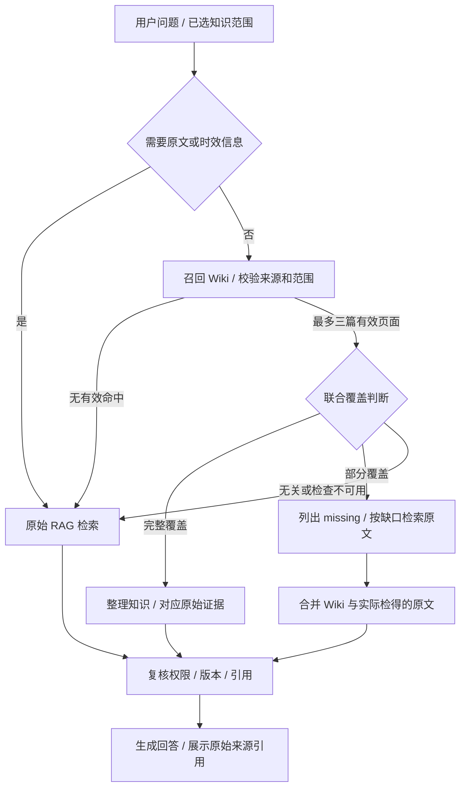
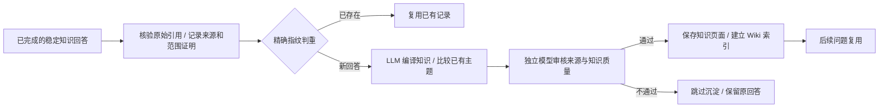
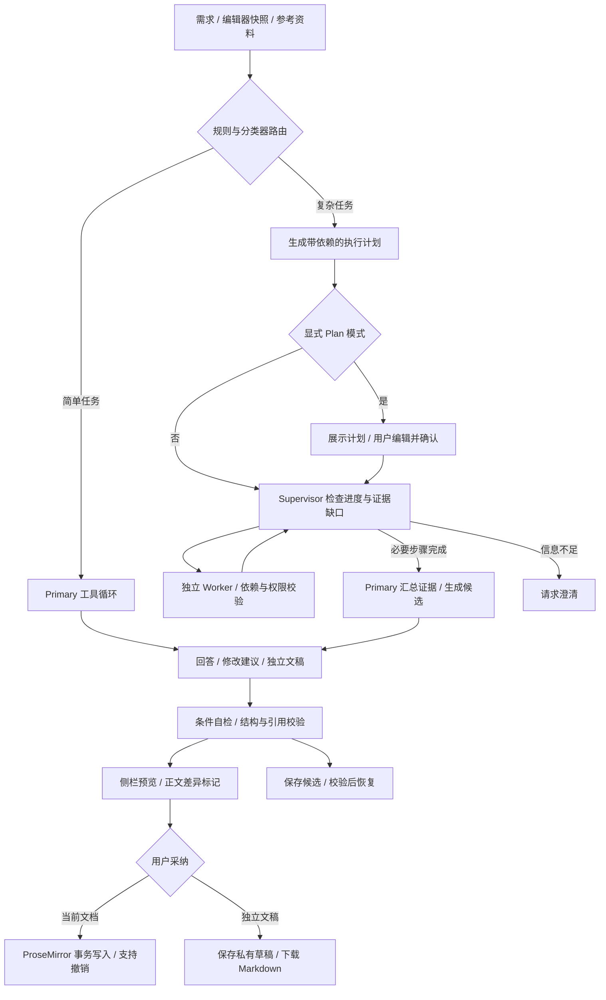
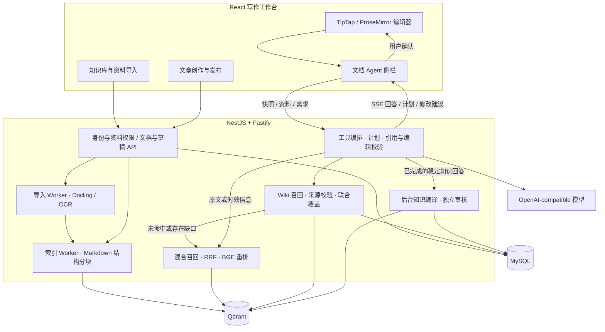

# LiveDoc · 智能文档工作台

LiveDoc 将知识资料、富文本编辑器和文档 Agent 放在同一个工作台中。从导入资料、检索原文，到规划文章、预览修改和发布内容，让知识积累直接参与写作。

项目受掘金的内容创作体验启发，进一步加入个人知识库、**LLM Wiki + RAG** 与上下文感知写作：RAG 从原始资料中检索证据，LLM Wiki 将经过审核的稳定知识沉淀为可复用页面；后续问题先检查整理知识的覆盖度，再按缺口补查原文。AI 可以读取资料、提出计划和生成修改建议，正文由用户确认后更新。

[主要功能](#主要功能) · [界面预览](#界面预览) · [Wiki + RAG 机制](#llm-wiki--rag-机制) · [Agent 实现](#文档-agentplan-and-execute-与工具执行) · [快速开始](#快速开始) · [系统架构](#系统架构) · [开发与验证](#开发与验证)

> 本仓库为 React 前端，当前后端为 [LiveDoc NestJS Server](https://github.com/seren-spark/livedoc_server_nest)。旧 Python 服务与多人协同编辑已停止维护。

## 主要功能

| 模块       | 能做什么                                                                           |
| ---------- | ---------------------------------------------------------------------------------- |
| 文档编辑   | 基于 TipTap / ProseMirror 编辑标题、列表、表格、代码、图片和公式，通过目录浏览长文 |
| 个人知识库 | 用最多三级分类整理文档，移动分类、使用笔记模板，并在回收站恢复资料                 |
| 资料导入   | 上传 PDF / Word，后台解析后进入编辑器预览、修改，确认保存后建立检索索引            |
| 知识检索   | 按个人、团队、公开资料及指定文档限定范围，结合关键词与向量检索找到相关原文         |
| 知识沉淀   | 稳定知识回答在后台整理为个人 LLM Wiki，检索时复用有效知识并按缺口补查原文         |
| 文档 Agent | 在 Ask、Plan、Agent 三种模式间切换，读取资料、回答问题、规划文章和提出编辑建议     |
| 定向编辑   | 结合正文、选区与光标上下文定位修改，查看前后对比，逐项接受或拒绝，支持撤销         |
| 引用核对   | 点击引用查看证据片段，并在版本与位置有效时定位原文                                 |
| 独立文稿   | 生成新文稿，预览表格与重点内容，保存为私有草稿或下载 Markdown                      |
| 结果恢复   | 刷新后重新打开助手，校验正文与资料版本后恢复最近结果、未处理建议和回答反馈         |
| 文章发布   | 管理草稿、发布和撤回文章，支持公开阅读、评论、回复、点赞与收藏                     |
| 检索观测   | 查看索引状态、检索延迟、无依据率与内容采纳率；技术详情按需展开                     |

联网检索、网页读取与深度思考由后端配置和模型能力决定；界面按实际可用能力提供入口。团队共享用于控制资料访问范围，编辑流程以个人操作为主。

## 界面预览

以下截图来自本地联调，正文、账号与生成内容为示例，用于展示编辑和确认流程。

**写作工作台：目录、富文本正文与结构化排版。**


| 可调整的写作计划                                                        | 逐项确认的正文修改                                                           |
| ----------------------------------------------------------------------- | ---------------------------------------------------------------------------- |
|  |  |
| 执行前调整目标、章节和约束，保存后再开始编写                            | 查看原文与建议的差异，决定每一处修改是否进入正文                             |

## 从资料到文稿

1. **收集资料**：在知识库新建文档，或上传 PDF / Word；解析完成后先核对正文。
2. **整理知识**：保存资料并建立索引，用分类和标签管理内容，按需选择个人、团队或公开资料范围。
3. **提问或规划**：在编辑器打开「AI 助手」，附加参考资料，先问清内容或整理写作计划。
4. **预览并采纳**：对照引用检查生成内容，接受所需修改，或保存为独立私有草稿。
5. **继续创作与发布**：知识文档保存到知识库；文章草稿通过创作者中心发布、更新或撤回。

### 三种助手模式

| 模式         | 适用场景                               | 操作方式                                     |
| ------------ | -------------------------------------- | -------------------------------------------- |
| Ask · 问答   | 解释概念、阅读资料、核对原文           | 返回回答与引用，不提供正文修改               |
| Plan · 规划  | 整理提纲、明确写作要求、拆解复杂任务   | 先生成可编辑计划，点击「按此计划执行」后编写 |
| Agent · 编写 | 润色选区、补充段落、重组正文或生成文稿 | 选择当前文档或独立文稿，预览后采纳           |

通过工具栏「AI 助手」或 `Ctrl / Cmd + Shift + K` 打开侧栏。参考资料支持知识文档、PDF、DOCX、TXT 和 Markdown；附件解析完成后可用于当前任务，不会自动存入知识库。

正文修改以发送时的编辑器快照为依据。生成过程中继续编辑，会使受影响的建议提示冲突；切换文档会取消当前任务。引用保留当时的原文和版本，来源变化后可对照片段核查。

同一浏览器会话内，刷新页面后重新打开助手，可以恢复该文档最近一次已完成结果。恢复前重新检查资料权限与版本，待采纳修改还需正文与生成时一致；正文变化或来源失效时提示重新生成。未完成任务显示中断状态，不会自动续跑。

## LLM Wiki + RAG 机制

LiveDoc 在原始资料之上维护个人整理知识层，让一次有依据的回答可以参与后续检索。两层知识通过同一个 `search_knowledge_base` 工具进入 Agent，用户继续使用原有的提问、引用核对和回答反馈流程。

| 知识层 | 保存什么 | 如何参与回答 |
| --- | --- | --- |
| 原始资料 / RAG | 用户文档、结构化分块、向量与关键词索引 | 检索原始证据，处理未覆盖的问题、原文核实及需要最新资料的问题 |
| LLM Wiki | 经过编译和独立审核的知识正文、来源坐标、适用范围与版本证明 | 复用已整理的事实与限制，联合判断当前问题覆盖度，并附带原始证据 |

### 1. 提问时：先查有效 Wiki，按缺口补查原文



一次检索最多选择三篇有效 Wiki，由模型判断这些页面的**联合内容**是否覆盖用户实际要求。同义问法、只问旧知识的一部分，以及检索词额外提及的内容，都不应被当成新的信息缺口。

| 判断结果 | 后续处理 |
| --- | --- |
| `full`：完整覆盖 | 返回整理知识及其原始来源片段，供 Agent 组织回答 |
| `partial`：部分覆盖 | 生成明确的 `missing` 清单，将缺失项加入原查询补检原文，返回 Wiki 与实际补到的证据；仍未找到的内容明确说明 |
| `none / unavailable`：无关或无法判断 | 使用原始 RAG；Wiki 失效、超时或内容超过上下文容量时同样回退原文 |

完整覆盖时可复用已有整理结果，仍需读取并核验其原始来源。Wiki 查询与覆盖检查合计最多使用 15 秒，为原文检索保留时间；用户取消任务时直接停止。根任务总预算耗尽时结束任务。

### 2. 回答后：后台编译、审核与知识沉淀



1. **筛选可沉淀回答**：回答已完成，引用全部来自可追溯知识文档，内容适合稳定复用；当前编辑快照、网页摘要或没有可靠来源的内容不直接进入自动沉淀。
2. **保留证据与适用范围**：记录来源文档、版本、片段位置与哈希、知识范围指纹，以及实际采用的 Wiki 祖先版本。
3. **编译知识正文**：模型围绕已核实事实整理主题、限制条件与引用，并比较同一有效资料范围内的相关知识。
4. **独立审核**：另一轮模型调用依据原始来源核验事实、引用及限制条件，同时检查可复用性、完整性和实质信息；通过后保存和索引。

沉淀发生在回答返回后的后台，不要求用户再次操作，也不修改原始资料。编译或索引失败单独记录，不改变已完成回答的终态。

### 3. 知识演进：去重、补充与冲突处理

| 与已有 Wiki 的关系 | 当前处理 |
| --- | --- |
| 完全相同的回答与来源指纹 | 跳过重复编译；指纹按稳定来源坐标绑定，避免不同历史引用标识干扰判重 |
| 语义重复 | 编译和独立审核均确认旧知识已覆盖全部事实及限制，且来源证明已包含时，复用旧页；换问法或只问一个子集也可以复用 |
| 兼容补充 | 保留旧正文、限制与引用，追加有原文支持的新内容，整体再审核；生成新的主题版本并记录前后继关系 |
| 独立主题 | 按新主题保存，不能只凭标题相近或来源相同合并 |
| 同条件下的事实冲突 | 两轮确认后标记冲突，停止旧知识直接复用，后续回到原始资料核实 |

例如，已有 Wiki 只整理了交付日期，用户询问“交付日期和验收负责人”。联合检查会把“验收负责人”列为缺口，补检授权原文后分别引用两项证据；没有找到负责人时明确说明缺失。如果另一篇有效 Wiki 已包含负责人，两篇可联合覆盖问题。

### 4. 来源失效与回答纠错

Wiki 的使用要求所有贡献来源仍可访问、版本及片段证明有效，并符合当前知识范围。文档更新、删除、撤权或资料范围变化后，旧 Wiki 停止复用，转向原始检索；返回工具结果和最终回答前还会再次核验。引用按原始来源坐标重绑定，用户可以核对真正支持结论的片段。

用户将回答标为“有误”时，后端取消该回答尚在进行的沉淀，撤回它产生或直接采用的 Wiki，并沿对应版本使派生知识失效；原始资料保留。前端通过回答反馈参与纠错，无需单独管理 Wiki 页面。

当前后台队列位于进程内，重启不续跑；每次联合检查最多三篇，仍受来源与上下文预算限制。范围指纹用于检测变化，系统尚不提供全库自动重编或自动解决所有事实冲突。实现与验收入口见 [后端机制说明（工作区）](../livedoc_server_nest/README.md#llm-wiki--rag-机制) 和 [Wiki 检索验收记录](../docs/wiki-retrieval-acceptance.md)。

## 文档 Agent：Plan-and-Execute 与工具执行

文档助手采用自定义的 **Supervisor 调度 + 独立 Worker 工具循环 + 条件自检 + 人工确认写入**。NestJS 的 `DocumentAgentService` 管理根任务，`AgentSupervisorService` 决定分步调度，`AgentRuntimeService` 隔离 Primary、Reader 和 Researcher 的消息、证据与工具权限；各角色在同一 API 进程中协作。分类、规划／主管和自检可以配置不同模型，默认复用主模型。

Ask、Plan、Agent 是用户选择的工作模式；`react` 和 `plan_execute` 是服务端选择的执行策略。两者分别决定“这轮可以产出什么”和“任务如何完成”。例如，Agent 模式下的选区润色可以直接走工具循环，多资料写作则可以先拆解计划。



### 1. 路由：简单任务直接处理，复杂任务先规划

服务端先通过 `ruleRoute` 匹配明确请求：用户确认过的计划优先执行；Plan 模式进入规划；多资料综合、全文重组和多步骤任务进入 `plan_execute`；明确的选区润色、续写或查找等任务进入 `react`。

规则无法判断时，分类模型结合需求、资料数量和是否存在选区选择策略，并返回简短原因。分类器不可用时进入直接工具循环；自动规划失败时也会回退到该策略，仍保留原有模式与资料权限约束。

### 2. Plan：把写作目标变成可执行步骤

计划使用结构化 `ExecutionPlan`，包含：

| 字段          | 用途                                                                                 |
| ------------- | ------------------------------------------------------------------------------------ |
| `goal`        | 本次任务要达成的目标                                                                 |
| `outline`     | 文稿的章节结构                                                                       |
| `constraints` | 篇幅、语气、资料范围与排版等要求                                                     |
| `steps`       | 最多 5 个步骤，每步包含描述、依赖 `depends_on` 与 `read / search / compose` 能力类型 |

服务端检查步骤标识、依赖是否存在及是否形成循环。进入执行后，Supervisor 通过 `dispatch / supplement / compose / clarify` 结构化决策选择下一步；服务端仅允许派发依赖已完成的任务。相互独立的读取、检索步骤最多并发 3 个，编写步骤单独执行。必要步骤全部成功后，由最终 Primary 汇总目标、约束、实际证据与引用，提交完整候选。

Reader 负责读取，Researcher 负责授权范围内的检索；每个 Worker 使用独立上下文，下游只接收成功依赖采用的引用和实际证据。生成正文修改的 Primary 必须自己读取目标，其他 Worker 的读取不能替代编辑前校验。

每个步骤还交接 `findings / missing / conflicts`：事实与冲突绑定已读取且实际采用的证据，服务端计算覆盖状态，主管据此补查、澄清或汇总。下游同时获得这些结构化信息和原始证据，不能把“步骤执行成功”视为“信息已齐全”。中间编写步骤须独立派发，不能提前跳过；最终候选仍由 Primary 统一提交。

**显式 Plan 模式**只生成计划，用户可以修改目标、章节、要求，增删和重排步骤；点击「按此计划执行」后，以新快照发送 `confirmed_plan`。手动编辑后的步骤按列表顺序形成依赖，用户确认的目标与约束优先于旧需求。

**Agent 模式的自动规划**用于执行已提出的复杂写作需求，内部计划可以直接进入执行。无论使用哪条路径，最终正文修改都需要用户采纳。

例如，“对比两份接口规范，补充现有方案的差异与迁移建议”可以拆成：读取规范 A、读取规范 B、对比差异、编写建议。前两步没有依赖时可以并行，对比步骤等待两份资料读完，最终候选再统一引用与排版。主管最多追加一次补查，累计仍不超过 5 步，保留用户确认的目标、约束和原步骤；信息不足时请求澄清，必要步骤失败时停止任务。

### 3. Execute：工具选择、执行与结果观察

每个步骤及最终合成都运行一个受预算约束的工具循环：模型选择一个当前可用工具，服务端验证工具名与 JSON Schema 参数，执行后把结果作为 `tool` 消息送回模型，再决定继续读取、检索或提交结果。

| 工具                               | 作用                                           |
| ---------------------------------- | ---------------------------------------------- |
| `read_current_document`            | 按区域、精确选区或分页读取发送时的编辑器快照   |
| `read_reference`                   | 分页读取本轮选择的知识文档、解析文件或文本资料 |
| `search_knowledge_base`            | 在用户明确选择的范围调用正式 RAG 检索链路      |
| `list_templates` / `read_template` | 获取可用写作模板与要求                         |
| `list_categories`                  | 读取当前用户的个人分类                         |
| `search_web` / 已授权 MCP 工具     | 在联网开关和服务配置允许时获取外部资料         |
| `finish_answer`                    | 提交只读回答或步骤中间结果                     |
| `submit_plan`                      | 在 Plan 模式提交计划并停止                     |
| `request_clarification`            | 信息不足时返回澄清问题，等待补充               |
| `propose_document_edits`           | 提交插入、替换或删除建议，等待采纳             |
| `propose_new_document`             | 提交独立文稿候选，等待保存                     |

工具按模式、输出位置、参考资料、知识库范围和联网设置裁剪。Ask 不开放编辑提交工具；计划中的步骤先按只读方式产出中间结果；最终编写阶段才允许提交与输出位置匹配的候选。

工具参数／结果协议出错时允许模型修复一次。模型限流、502／503／504 和已识别的临时网络故障最多重试一次模型请求；权限失效、来源版本变化和预算不足直接终止，不自动重放工具或写入。循环内可以扩展一次当前权限允许的工具集；子任务第四轮仅开放结果／澄清工具，提交已核实事实与仍缺失的信息。

### 4. 上下文与记忆：先看结构，再按需读原文

前端发送标题、文档身份与版本、完整 TipTap JSON、正文区域、选区和光标前后文。服务端先向模型提供区域目录、短预览、参考资料清单、已选知识范围、会话记忆与适用的文档记忆，正文通过工具按需读取。知识范围中的相关问题优先检索该范围，资料缺项时明确说明。

- 正文区域以 `b0`、`b1` 等标识关联本次快照，后续编辑建议直接指向这些区域或选区。
- 长文和参考资料按页读取，保留下一页位置与已读范围；修改前必须先读取完整目标区域，选区修改必须精确读取选区。
- 每次模型调用前计算消息与工具 Schema 的 Token 预算，预留输出与安全余量；较长的历史工具内容可以压缩，同时保留引用及分页元信息。
- 压缩后仍超出模型窗口时，返回缩小范围的提示；需要精确改写时重新读取原文。全文类回答未读完正文时，会明确说明实际读取范围。
- 会话中保存的未采纳结果带有候选标记，当前快照优先于历史候选。

### 5. Reflection：有条件地检查与修正候选

独立文稿、多条修改建议，以及开启深度思考时的回答或编辑结果，会进入一次模型自检。自检对照任务目标、计划、引用证据和模板要求，检查遗漏要求、无依据断言、矛盾、结构及风格问题。

发现问题后最多修正一次候选，保留结果类型与已有引用，并再次执行结构校验。当前没有第二轮模型复审；自检调用失败或超时时显示“自检未完成”，候选仍需通过后续确定性校验和用户确认。模型自检用于辅助检查，资料权限、引用存在性和编辑范围由代码校验。

### 6. Human-in-the-loop：从候选到可撤销的编辑

`propose_document_edits` 返回结构化操作：`insert_before / insert_after / replace / delete`，每项附带目标、解释与引用。服务端检查引用是否存在、目标是否读过、修改是否重叠、Markdown 与链接格式是否允许，并在返回前复核资料权限和版本。

前端用 ProseMirror Plugin 与 `DecorationSet` 标记待处理位置，侧栏展示原文和建议。标记不直接改正文；接受建议时才把 Markdown 转换为编辑器节点，校验后通过事务写入。

用户继续手动编辑时，`Transaction.mapping` 跟踪建议位置；目标内容发生变化的建议标为冲突，其余建议可以继续处理。全部接受在一个事务中完成，可一次撤销。独立文稿采纳后保存为私有、未索引草稿，后续由用户继续编辑和建立索引。

### 7. 执行状态、取消与预算

`POST /ai/agent` 通过 SSE 推送任务状态、路由、计划、步骤、工具执行、自检和最终结果。事件带 `run_id` 与递增 `seq`，前端检查顺序，并要求收到终态 `done`；中断连接不会被当作已完成候选。

当前回答和文稿的 `delta` 是候选完成校验后分段发送，执行中的进度来自步骤与工具事件。

| 控制项       | 当前行为                                                                   |
| ------------ | -------------------------------------------------------------------------- |
| 计划与并发   | 最多 5 步；独立读取、检索最多并发 3 个；手动编辑计划按列表顺序执行         |
| 执行循环     | 默认共享 12 轮循环预算，单个步骤最多 4 轮，每轮提交一个工具调用            |
| 模型累计预算 | 默认最多 30 次请求、120000 Token；分类、主管、压缩、自检、Wiki 覆盖判断和内置联网搜索统一计入 |
| 最终交付预留 | 研究阶段预留 8192 Token 和两次模型请求；并发调用发出前先预留额度           |
| 超时与取消   | 默认任务总时限 300 秒；停止、切换文档或连接关闭通过 AbortSignal 取消执行   |
| 人工处理     | 修改建议和独立文稿进入 `awaiting_review`；需要澄清时进入 `needs_input`     |
| 运行记录     | 保存候选、采用引用、覆盖信息、选区描述及反馈；记录各角色与模型／工具调用追踪，不保存原始推理链 |
| 结果恢复     | 重新校验权限、版本和正文后恢复最近已完成结果；过滤已处理建议，恢复回答反馈状态 |
| 当前运行边界 | 单 API 默认最多 6 个执行任务；未完成任务不自动续跑，多实例共享调度尚未实现 |

默认循环预算、任务超时和输出预算分别通过 `AGENT_MAX_TOOL_CALLS`、`AGENT_TIMEOUT_SECONDS`、`AGENT_MAX_OUTPUT_TOKENS` 配置。分类、规划、自检模型可分别设置 `AGENT_CLASSIFIER_MODEL`、`AGENT_PLAN_MODEL`、`AGENT_CRITIC_MODEL`，留空复用 `LLM_MODEL`。深度思考需模型支持及对应请求参数，联网工具需另行配置并在本轮启用。

累计预算和并发配置为 `AGENT_MAX_TOTAL_TOKENS`、`AGENT_MAX_MODEL_REQUESTS`、`AGENT_FINALIZATION_TOKENS`、`AGENT_MAX_CONCURRENT_RUNS`。失败、取消或供应商未返回用量时保留估算扣账，额度控制不等于精确账单。

后端在现有运行表中保存通过校验的候选，无需为本轮 Agent 改造新增迁移。浏览器会话仅记录运行 ID 与原选区位置；恢复接口返回结果前重新验证来源，审计查询只返回元数据。数据库故障降级为进程内结果时，无法跨服务重启恢复。调用追踪记录耗时、模型、Token、错误码、尝试次数与提示词／工具版本，不记录提示词、工具正文或凭证。

### 8. 关键源码

| 入口                                                                                                                  | 实现内容                                                       |
| --------------------------------------------------------------------------------------------------------------------- | -------------------------------------------------------------- |
| [DocumentAgentService](https://github.com/seren-spark/livedoc_server_nest/blob/main/src/ai/document-agent.service.ts) | 根任务生命周期、路由、自检、候选校验与恢复 |
| [AgentSupervisorService](https://github.com/seren-spark/livedoc_server_nest/blob/main/src/ai/agent-supervisor.service.ts) | 依赖调度、补查、汇总与澄清决策 |
| [AgentRuntimeService](https://github.com/seren-spark/livedoc_server_nest/blob/main/src/ai/agent-runtime.service.ts) | 独立 Worker 上下文、角色工具权限和实际证据交接 |
| [预算与失败策略](https://github.com/seren-spark/livedoc_server_nest/blob/main/src/ai/agent-execution.ts) | 并发预算预留、错误分类与调用追踪 |
| [Agent 结果校验](https://github.com/seren-spark/livedoc_server_nest/blob/main/src/ai/document-agent.validation.ts)    | 计划无环检查、模式约束、引用、Markdown 与修改范围校验          |
| [LLM 适配](https://github.com/seren-spark/livedoc_server_nest/blob/main/src/ai/llm.service.ts)                        | 角色模型选择、Function Calling 与思考参数                      |
| [DocumentAgentPanel](src/components/Knowledge/DocumentAgentPanel.tsx)                                                 | 发送快照、展示进度、引用预览、候选采纳、取消与刷新恢复         |
| [AgentPlanEditor](src/components/Knowledge/AgentPlanEditor.tsx)                                                       | 用户编辑目标、章节、要求与步骤                                 |
| [编辑器事务](src/lib/document-agent-editor.ts)                                                                        | 快照、Decoration、位置映射、冲突检测与事务采纳                 |
| [Agent 请求客户端](src/api/document-agent.ts)                                                                         | 事件解析、顺序校验、终态检查及结果恢复接口                     |
| [回答反馈](src/components/Knowledge/AgentAnswerFeedback.tsx)                                                          | 回答质量反馈与已保存反馈状态恢复                               |

## 快速开始

### 环境要求

| 组件     | 要求与用途                                                                            |
| -------- | ------------------------------------------------------------------------------------- |
| Node.js  | 22.12+，运行前端与 NestJS 服务                                                        |
| npm      | 10+，安装依赖与运行脚本                                                               |
| MySQL    | 8.x，保存文档、草稿、任务、会话与反馈                                                 |
| Qdrant   | 保存 Dense / Sparse 检索索引                                                          |
| Python   | 用于 Docling / RapidOCR 文档解析，安装方式见后端配置文档                              |
| 模型服务 | 支持工具调用的 OpenAI-compatible 接口；Embedding 与 BGE 重排通过 Transformers.js 加载 |

当前提供源码运行方式。首次配置数据库、模型和解析环境，请先阅读 [本地真实 RAG 配置](https://github.com/seren-spark/livedoc_server_nest/blob/main/docs/LOCAL_REAL_RAG_SETUP.md)。

### 1. 获取前后端

在同一个父目录检出两个仓库：

```bash
git clone --branch feat/knowledge https://github.com/seren-spark/livedoc.git
git clone https://github.com/seren-spark/livedoc_server_nest.git
```

### 2. 配置并启动后端

在后端目录执行；以下复制命令使用 PowerShell：

```powershell
cd livedoc_server_nest
npm ci
Copy-Item .env.example .env
```

编辑 `.env`，配置数据库、Qdrant、模型接口和解析 Python 路径。保留示例中的真实运行模式，按实际前端地址设置 `ALLOWED_ORIGINS`。模型首次加载需要下载或准备本地缓存。

配置完成且 MySQL、Qdrant 已启动后执行：

```powershell
npm run db:migrate
npm run qdrant:init
npm run config:check:live
npm run dev
```

`npm run dev` 会同时启动 API、索引 Worker 和导入 Worker。只启动 API 时，解析或索引任务不会被消费。默认 API 的存活检查地址为 [http://127.0.0.1:8001/health/live](http://127.0.0.1:8001/health/live)。

### 3. 启动前端

另开终端，从检出仓库的父目录进入前端：

```powershell
cd livedoc
npm ci --legacy-peer-deps
Copy-Item .env.example .env.local
npm run dev
```

`.env.local` 中与当前主流程相关的配置为：

```dotenv
VITE_RAG_API_BASE_URL=http://127.0.0.1:8001
VITE_ENABLE_MOCK=false
```

打开终端输出的 Vite 地址，默认通常为 [http://localhost:5173](http://localhost:5173)。端口变化时，同步调整后端 `ALLOWED_ORIGINS`。`VITE_API_BASE_URL` 为既有业务接口配置，知识库、文档 Agent 和文章主流程使用 `VITE_RAG_API_BASE_URL`。

### 4. 体验完整流程

在登录窗口选择演示账号，默认密码为 `Demo@123456`：

| 账号                  | 资料权限体验                      |
| --------------------- | --------------------------------- |
| `alice@livedoc.local` | Alice 的个人资料与 Alpha 团队资料 |
| `bob@livedoc.local`   | Bob 的个人资料与 Alpha 团队资料   |
| `carol@livedoc.local` | Carol 的个人资料与 Beta 团队资料  |

进入知识库，点击「演示数据」准备资料，或自行创建、导入文档。等待索引就绪后打开编辑器，即可体验检索、引用核对与写作。演示身份用于本地联调。

| 页面           | 路径                           |
| -------------- | ------------------------------ |
| 知识库管理     | `/knowledge`                   |
| 文章写作       | `/editor/draft`                |
| 知识文档写作   | `/editor/draft?mode=knowledge` |
| 草稿与发布管理 | `/creator/articles`            |
| 收藏文章       | `/creator/favorites`           |
| 公开文章列表   | `/synthesis`                   |
| 文章阅读       | `/post/:id`                    |

## 系统架构



### 检索如何参与写作

- **入库**：Markdown 按结构与 Token 预算分块，生成稠密向量与稀疏向量，写入 Qdrant。
- **召回**：结合关键词与语义检索，经 RRF 融合、BGE 重排、去重和上下文压缩选取证据。
- **整理知识复用**：稳定知识回答在后台编译、审核并沉淀为个人 LLM Wiki；检索时联合检查覆盖度，按缺失项补查原文，引用仍指向实际采用的原始证据。来源失效或检查不可用时回退原始 RAG。
- **权限**：根据当前用户、资料范围、发布状态与有效索引版本约束可读取内容。
- **生成**：通过工具调用读取证据，返回带引用的回答、计划或结构化修改建议。
- **确认**：前端先展示结果与差异，检查引用和编辑位置，再由用户采纳；反馈关联对应运行记录。

Wiki 继承所有贡献来源的访问权限、版本及片段证明。前端不提供独立 Wiki 管理入口，用户可通过回答反馈标记有误，后端停止相关沉淀并撤回对应整理知识。沉淀失败不影响已完成回答；后台队列目前在进程内，重启不续跑。

### 技术栈

| 领域       | 技术                                                                    |
| ---------- | ----------------------------------------------------------------------- |
| 前端       | React 18、TypeScript、Vite 7、React Router                              |
| 编辑器     | TipTap 3、ProseMirror、自定义 Extension / Plugin                        |
| 界面与状态 | Ant Design 5、UnoCSS、Sass、Redux Toolkit、TanStack Query               |
| 内容渲染   | React Markdown、remark-gfm、KaTeX、highlight.js                         |
| 后端       | Node.js、TypeScript、NestJS 11、Fastify 5                               |
| 存储与任务 | MySQL、TypeORM、持久化任务队列、本地文件存储                            |
| 检索与推理 | Qdrant、Jieba、Transformers.js、BGE Embedding / Reranker、Worker Thread |
| 解析与评测 | Docling、RapidOCR；EvalScope、MTEB、RAGAS                               |

## 开发与验证

### 前端

在本仓库根目录执行：

```bash
npm test
npx tsc -p tsconfig.app.json --noEmit
npm run build
```

`npm run build` 包含 TypeScript project build 与 Vite 生产构建。格式与静态检查入口为 `npm run format:check`、`npm run lint:check`。

### 后端与真实链路

在 `livedoc_server_nest` 中执行：

```bash
npm run type-check
npm test
npm run build
npm run validate:e2e:real
```

真实验收覆盖导入、确认入库、索引、检索、工具调用、生成、引用与反馈；需要已配置的数据库、模型和解析环境。

### 多 Agent 对照评测与当前验证状态

在后端目录执行 `npm run validate:agents` 检查五组固定合成问题及事实原文绑定；执行 `npm run eval:agents` 使用真实模型，对同一问题分别运行直接执行与已确认多步骤计划，检查事实同行引用对应原文、资料范围、冲突／缺口及禁止编造的金额。题集包含条件／例外保留和多层依赖汇总。脚本强制数据库、向量和记忆使用隔离内存数据，禁用 MCP 与后台 Wiki 编译，只发送新建合成资料。

`npm run test:agent-gates` 运行无需模型凭证的交接、权限、预算、主管决策、取消、恢复及 Wiki 失效回归；后端 GitHub Actions 在 push／PR 执行该回归、构建、类型检查和题集校验。真实模型评测单独运行，确定性检查不等于完整语义支持率。

2026-10-24 的五题真实模型对照中，多步骤执行 5/5 通过，直接执行 4/5 通过；直接执行的条件／例外题耗尽轮数，整体评测返回失败。直接执行合计 55699 Token，多步骤合计 126564 Token，P95 分别为 14.777 秒和 35.936 秒，均包含失败任务。早前轮次的失败记录保留，不能由这五题推断总体准确率或稳定性。

本轮后端类型检查、构建及受控专项 12 套、138 项通过，前后端 README 同步交接机制与验证边界；真实 MySQL 结果持久化与页面人工采纳仍待验收，现有服务尚未重启。工作区详细记录见 [交接与业务回归验收](../docs/agent-handoff-acceptance.md)，原始结果见 [Agent 对照报告](../docs/agent-evaluation.json)。

### RAG 评测

后端提供冻结语料、问题与 Chunk 标注，用于检索策略对比、实际入模证据核验和答案质量分析。入口包括：

| 入口                           | 用途                                                    |
| ------------------------------ | ------------------------------------------------------- |
| `npm run eval:retrieval:fixed` | 计算 Chunk Recall、MRR、NDCG 与候选池覆盖，保留失败样例 |
| `npm run eval:answers`         | 采集实际问答及该轮使用的证据                            |
| `npm run eval:judge`           | 核验回答、参考事实与证据的支持关系                      |
| `npm run eval:frameworks`      | 通过 EvalScope / MTEB / RAGAS 运行模型与生成质量评测    |

题集准备、运行参数、原始结果和适用范围见 [RAG 评测指南](https://github.com/seren-spark/livedoc_server_nest/blob/main/docs/rag-evaluation.md)。合成题集的结果用于回归和机制诊断，业务效果需要真实资料与人工复核。

## 项目结构

```text
src/
├── api/
│   ├── rag.ts                     # 知识库、导入、引用、检索与反馈接口
│   ├── document-agent.ts          # Agent 请求与 SSE 事件消费
│   ├── workspace.ts               # 分类、模板与回收站
│   └── articles.ts                # 文章草稿、发布与互动
├── components/Knowledge/
│   ├── DocumentAgentPanel.tsx     # 文档助手、参考资料与结果预览
│   ├── AgentPlanEditor.tsx        # 写作计划编辑
│   ├── AgentMarkdown.tsx          # 表格、高亮与引用渲染
│   └── WorkspaceNavigation.tsx    # 个人分类、模板与回收站入口
├── hooks/
│   ├── useKnowledgeDocumentSession.ts
│   └── useArticleSession.ts       # 知识文档与文章的保存流程
├── lib/
│   ├── document-agent-editor.ts   # 编辑建议、冲突检测与采纳事务
│   └── citation-location.ts       # 引用定位
└── pages/
    ├── knowledge/                # 知识库管理
    ├── editor/                   # 写作工作台与编辑器扩展
    ├── creator/                  # 创作者中心
    └── post/                     # 文章阅读
```

## 更多文档

- [后端概览与运行说明](https://github.com/seren-spark/livedoc_server_nest)
- [本地真实 RAG 配置](https://github.com/seren-spark/livedoc_server_nest/blob/main/docs/LOCAL_REAL_RAG_SETUP.md)
- [文档 Agent、个人知识管理与可选能力](https://github.com/seren-spark/livedoc_server_nest/blob/main/docs/document-agent.md)
- [Markdown 结构分块](https://github.com/seren-spark/livedoc_server_nest/blob/main/docs/MARKDOWN_CHUNKING.md)
- [RAG 评测与结果说明](https://github.com/seren-spark/livedoc_server_nest/blob/main/docs/rag-evaluation.md)

## 参考

- [掘金](https://juejin.cn/)：内容创作与文章阅读场景。
- [LearnHub](https://github.com/luyiyanyumu/LearnHub)：知识工作台的展示方式与固定知识库评测思路。
